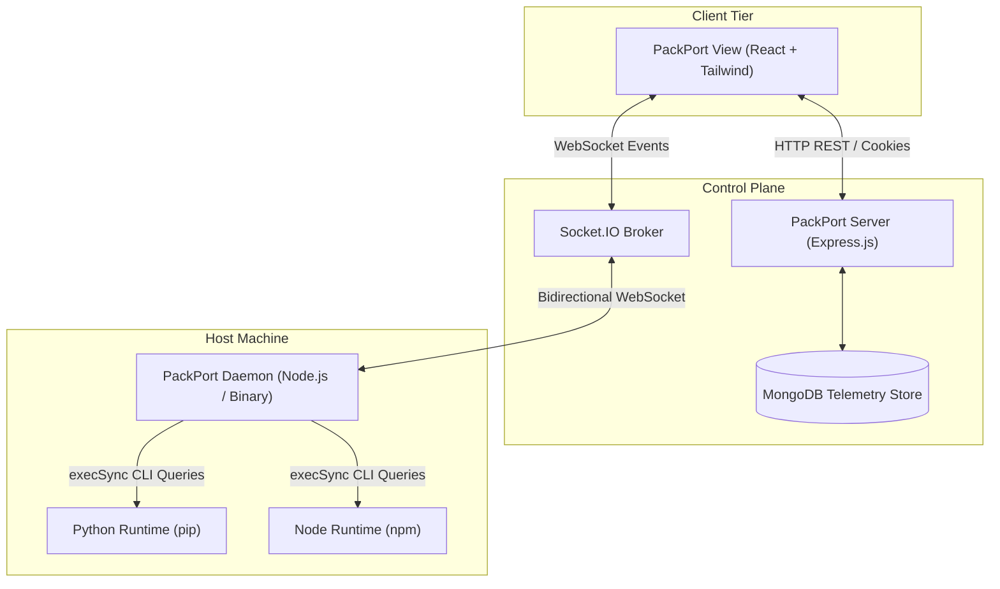
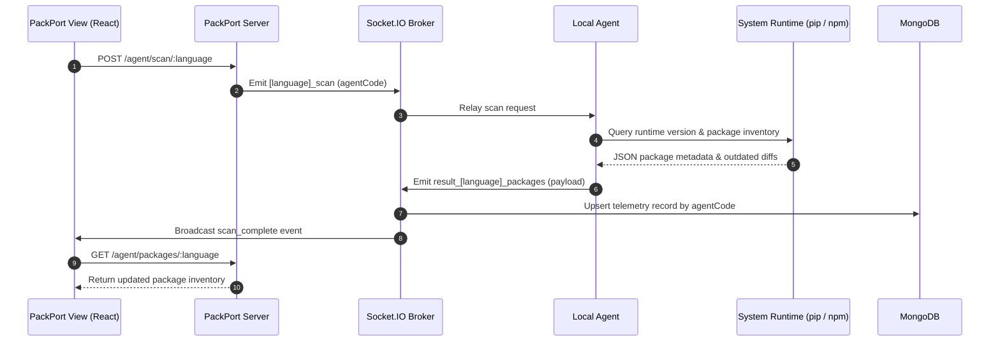
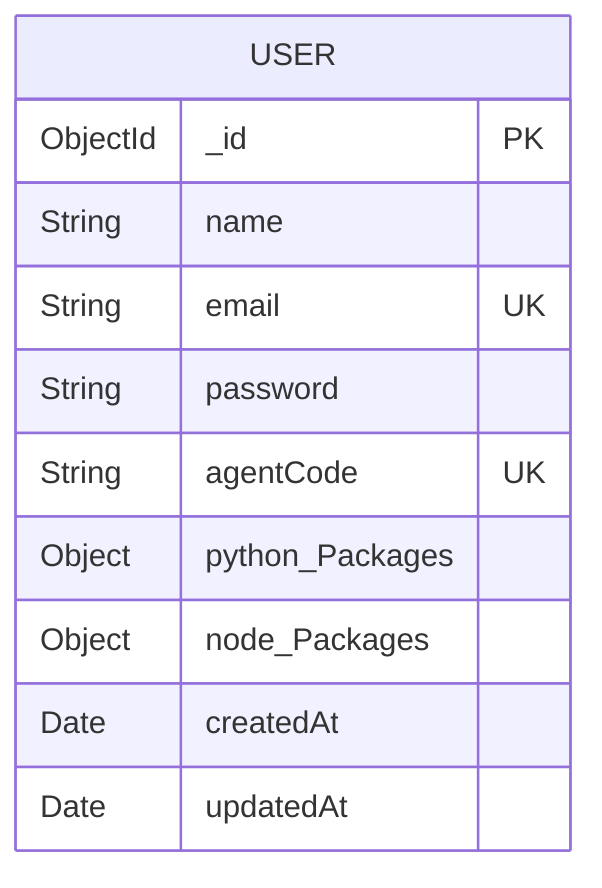

# PackPort

[](https://packport-docs.vercel.app/)
[](https://nodejs.org)
[](https://python.org)

PackPort is a centralized package telemetry and remote runtime maintenance platform for developer environments. It provides real-time visibility into global runtime environments, installed dependencies, and outdated packages across Python (`pip`) and Node.js (`npm`) ecosystems, paired with remote upgrade execution through a lightweight local daemon.

---

## Links & Resources

| Resource | URL | Description |
| :--- | :--- | :--- |
| **Documentation Portal** | [https://packport-docs.vercel.app/](https://packport-docs.vercel.app/) | Interactive architecture diagrams and telemetry flows |
| **GitHub Repository** | [https://github.com/ShauryaGupta2006/PackPort](https://github.com/ShauryaGupta2006/PackPort) | Source code and version control |
| **Production Web Dashboard** | `https://your-dashboard-url.com` | Deployed administrative frontend |
| **Control Plane API** | `https://your-api-url.com` | Backend REST API & WebSocket server |
| **Issue Tracker** | [https://github.com/ShauryaGupta2006/PackPort/issues](https://github.com/ShauryaGupta2006/PackPort/issues) | Bug reports and feature requests |

---

## Architecture Overview

PackPort operates on a three-tier decoupled architecture comprising a web dashboard, a centralized control plane server, and a local background agent.



### Telemetry & Command Lifecycle



---

## Core Components

### 1. Web Dashboard (`View/`)
The frontend client provides an administrative interface for runtime monitoring, package auditing, and remote maintenance triggers.
- **Framework:** React 19 with Vite
- **Styling:** Tailwind CSS with Radix/Base UI components and Lucide icons
- **State & Transport:** Axios for REST communication, `socket.io-client` for real-time telemetry updates and progress synchronization

### 2. Control Plane & API Gateway (`server/`)
The server coordinates authentication, agent-to-user routing, persistent storage, and WebSocket signaling.
- **Runtime:** Node.js with Express 5
- **Real-Time Layer:** Socket.IO server with cross-origin session support
- **Persistence:** MongoDB with Mongoose ODM
- **Authentication:** JSON Web Tokens (JWT) stored in HTTP-only `SameSite=Lax` cookies; bcrypt-hashed passwords

### 3. Local Runtime Agent (`agent/`)
A lightweight client utility that runs on the developer's target workstation.
- **Binary Detection:** Automatically identifies Python binaries (`python`, `python3`, `py`) and Node environments (`node`, `npm`).
- **Telemetry Extraction:** Executes structured package discovery via native tooling (`pip list --outdated --format=json`, `npm outdated -g --json`, `npm list -g --depth=0 --json`).
- **Remote Operations:** Listens for remote update directives and orchestrates non-interactive package upgrades.
- **Packaging:** Self-contained executable compilation using `@vercel/pkg`.

---

## WebSocket Event Specification

Communication between the Control Plane, UI, and Local Agent is mediated through Socket.IO events:

| Event Name | Direction | Payload Structure | Description |
| :--- | :--- | :--- | :--- |
| `python_scan` | Server -> Agent | `agentCode` (string) | Signals the agent to inspect Python environments. |
| `node_scan` | Server -> Agent | `agentCode` (string) | Signals the agent to inspect Node.js global packages. |
| `result_python_packages` | Agent -> Server | `{ agentCode, pythonVersion, all_packages, outdated_packages }` | Telemetry payload containing Python dependencies. |
| `result_node_packages` | Agent -> Server | `{ agentCode, node_version, npm_version, all_packages, outdated_packages }` | Telemetry payload containing Node.js dependencies. |
| `scan_complete` | Server -> UI | `{ language, agentCode, timestamp }` | Notifies the UI that fresh telemetry has been persisted. |
| `update_python` | Server -> Agent | `{ agentCode, packageName }` | Instructs the agent to execute `pip install --upgrade <pkg>`. |
| `update_node` | Server -> Agent | `{ agentCode, packageName }` | Instructs the agent to execute `npm install -g <pkg>@latest`. |
| `package_update_started` | Server -> UI | `{ agentCode, packageName, language, timestamp }` | Broadcasts active upgrade execution status to the UI. |

---

## REST API Reference

All `/agent/*` endpoints require authentication via the `accessToken` cookie.

### Authentication Endpoints

#### `POST /auth/signup`
Creates a user account and generates a unique pairing `agentCode`.
- **Request Body:**
  ```json
  {
    "name": "Jane Doe",
    "email": "jane@example.com",
    "password": "SecurePassword123",
    "confirm_password": "SecurePassword123"
  }
  ```
- **Response (200 OK):** Sets HTTP-only `accessToken` cookie and returns user metadata.

#### `POST /auth/login`
Authenticates credentials and establishes session.
- **Request Body:**
  ```json
  {
    "email": "jane@example.com",
    "password": "SecurePassword123"
  }
  ```
- **Response (200 OK):** Sets HTTP-only `accessToken` cookie.

#### `GET /auth/check`
Validates session token and returns active user profile.

#### `GET /auth/logout`
Clears session cookie and invalidates client session.

### Agent & Telemetry Endpoints

#### `GET /agent/status`
Returns user account information, associated `agentCode`, and metadata regarding telemetry freshness.

#### `GET /agent/packages/:language`
Retrieves stored telemetry for the authenticated user's registered agent.
- **Path Parameter:** `language` (`python` | `node` | omit for both)

#### `POST /agent/scan/:language`
Triggers an immediate telemetry scan on the connected agent for the given ecosystem.
- **Path Parameter:** `language` (`python` | `node`)

#### `POST /agent/update/:pkgName`
Dispatches a package upgrade command to the connected agent.
- **Path Parameter:** `pkgName` (string)
- **Request Body:**
  ```json
  {
    "language": "python",
    "packageName": "requests"
  }
  ```

---

## Database Schema



### Telemetry Subdocuments Structure

```javascript
{
  python_Packages: {
    version: String,           // e.g., "Python 3.11.4"
    all_packages: [
      { name: String, version: String }
    ],
    outdated_packages: [
      { name: String, version: String, latest_version: String, type: String }
    ],
    lastScanned: Date
  },
  node_Packages: {
    node_version: String,      // e.g., "v20.10.0"
    npm_version: String,       // e.g., "10.2.3"
    version: String,
    all_packages: [
      { name: String, version: String }
    ],
    outdated_packages: [
      { name: String, version: String, latest_version: String, type: String }
    ],
    lastScanned: Date
  }
}
```

---

## Environment Configuration

### Server Configuration (`server/.env`)
```env
PORT=5600
DB_URI=mongodb+srv://<username>:<password>@cluster.mongodb.net/packport
JWT_SECRET=your_jwt_signing_secret_min_32_chars
FrontEnd_URI=http://localhost:5173
```

### Frontend Configuration (`View/.env`)
```env
VITE_BACKEND_URL=http://localhost:5600
```

### Agent Configuration (`agent/.env`)
```env
BACKEND_URI=http://localhost:5600
```

---

## Local Development Setup

### Prerequisites
- Node.js 18.x or later
- npm 9.x or later
- MongoDB instance (local or Atlas cluster)
- Python 3.8+ with pip (for testing Python telemetry)

### 1. Control Plane Server
```bash
cd server
npm install
npm run dev # or: node server.js
```
The server will start on port `5600` (or the configured `PORT`).

### 2. Web Dashboard
```bash
cd View
npm install
npm run dev
```
The development server will mount at `http://localhost:5173`.

### 3. Local Agent
```bash
cd agent
npm install
npm start # or: node agent.js
```

---

## Binary Compilation & Distribution

The agent can be packaged into standalone platform binaries using `@vercel/pkg`:

### Windows Executable
```bash
cd agent
npm run build:exe
# Outputs: PackPortAgent.exe
```

### macOS Binary
```bash
cd agent
npx pkg agent.js --targets node18-macos-x64 --output PackPort-mac-x64
chmod +x PackPort-mac-x64
```

---

## Security Architecture

1. **Authentication & Session Tokens:** All web requests rely on signed JWTs stored in HTTP-only, `SameSite=Lax` cookies, mitigating cross-site scripting (XSS) credential theft.
2. **Agent Isolation:** Telemetry queries and upgrade commands are partitioned using unique, cryptographically random `agentCode` tokens assigned per account.
3. **Execution Sandbox:** The agent executes CLI commands synchronously with standard error capture and structured JSON outputs to prevent uncontrolled process spawning.
